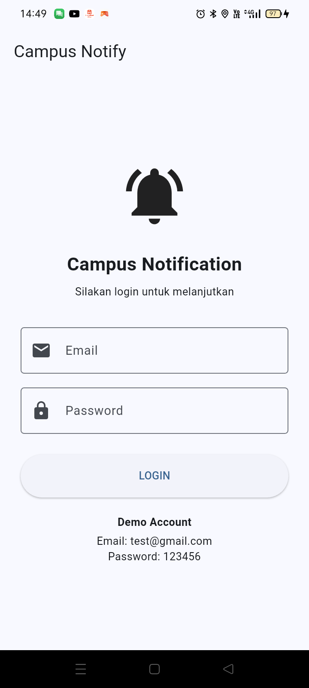
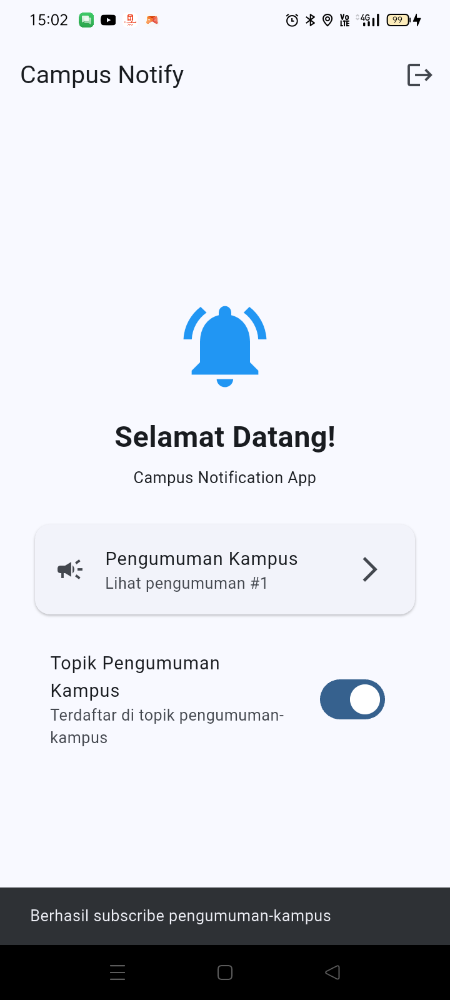
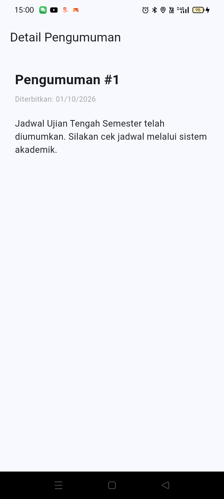

# Laporan Jobsheet #08 — Mid Project Review & Code Review (campus_notify)

> Mata kuliah: Pemrograman Mobile · Minggu 8 · Project: `campus_notify`
> (auth + FCM + pengumuman, hasil refactor Clean Architecture Minggu 7)
> Perangkat uji: OPPO CPH2269, Android 11 · Tanggal: 27 Oktober 2026

**Daftar isi:**

1. [Praktikum 1 — Hygiene branch dan commit](#praktikum-1--hygiene-branch-dan-commit)
2. [Praktikum 2 — PR dan peer review](#praktikum-2--pr-dan-peer-review)
3. [Praktikum 3 — Static analysis dan mid review](#praktikum-3--static-analysis-dan-mid-review)
4. [AI Challenge](#ai-challenge)
5. [Refactoring Challenge & Testing](#refactoring-challenge--testing)
6. [Status paruh semester & peta issue/PR](#status-paruh-semester--peta-issuepr)
7. [Cara menjalankan & hasil screenshot](#cara-menjalankan--hasil-screenshot)
8. [Refleksi](#refleksi)

Codelab minggu ini bukan membuat aplikasi baru — project yang saya review adalah
`campus_notify` hasil Minggu 7. Yang dinilai adalah **disiplin kolaborasi**:
Git Flow, commit dan PR yang layak review, peer review yang konstruktif,
mesin static analysis yang hijau, dan kemampuan memverifikasi saran AI
sebelum diterapkan.

---

## Praktikum 1 — Hygiene branch dan commit

Saya audit riwayat saya sendiri dengan `git log --oneline -15`, `git branch -a`,
dan `git status`. Hasilnya jujur saja kurang enak dilihat:

- semua commit minggu 1–7 masuk **langsung ke `main`**, tanpa `develop`, tanpa PR;
- pesan commit seperti `Laporan Praktikum`, `Terminate Testing`, `Background` —
  tidak ada satu pun yang format `tipe(scope): deskripsi`;
- ada dua commit kembar `Praktikum Jobsheet 6` yang tidak jelas bedanya;
- folder minggu 8 sempat lama tidak di-commit (untracked).

Perbaikan yang saya lakukan minggu ini:

1. `develop` saya buat **sekali** dari `main`, lalu snapshot hasil minggu 7
   saya commit ke sana: `c118ad6 chore(week8): snapshot campus_notify hasil minggu 7 untuk mid project review`.
2. Kerja harian tidak lagi di `develop`, melainkan di branch
   `feat/week8-review-discipline` — satu branch untuk satu tujuan.
3. Tiap commit satu tanggung jawab, dan staging saya seleksi per kelompok file
   (praktik `git add -p`) supaya diff bisa dibaca reviewer:

| Commit | Isi |
|---|---|
| `5650d72 style(week8): dart format murni...` | hanya 18 file hasil `dart format`, nol perubahan perilaku |
| `f6d74c5 fix(auth): guard session null di SignIn + smoke test pakai fake DI` | perbaikan bug + 2 test, **tidak** tercampur format |
| `6b4dfe7 chore: keluarkan folder Modul dari pelacakan git` | `.gitignore` untuk materi kuliah agar tidak menodai diff project |
| `5063cbb ci(week8): tolak PR kotor...` | `.github/workflows/ci.yml` |
| `7fdb1e2 docs(week8): review checklist...` | dua dokumen di `docs/` |

4. Tabel rewrite 3 commit lama + alasannya ada di
   [`docs/review-checklist.md`](docs/review-checklist.md) §2, hasil audit lengkap §1.

## Praktikum 2 — PR dan peer review

Branch `feat/week8-review-discipline` saya ajukan sebagai **PR kecil ke `develop`**
(5 commit, di bawah 300 baris perubahan perilaku, bisa direview < 15 menit).
Template PR saya isi: masalah → solusi → cara uji → screenshot, plus `Closes #<issue>`
agar issue tertutup otomatis saat merge.

Aturan yang saya pegang saat menjadi reviewer pasangan maupun khi review:
pola komentar **observasi → dampak → usulan konkret**, minimal 2 temuan kebenaran +
1 arsitektur + 1 test + 1 keterbacaan, dan keputusan akhir harus eksplisit
(*Approve* atau *Request changes*). Bersikap keras pada kode, baik pada manusia.

Hasil peer review beserta tindak lanjutnya saya catat di bagian
[status paruh semester](#status-paruh-semester--peta-issuepr) dan thread PR di GitHub.

## Praktikum 3 — Static analysis dan mid review

Tiga perintah wajib, semuanya hijau di `campus_notify`:

```
$ flutter analyze
No issues found! (ran in 5.8s)

$ dart format --output=none --set-exit-if-changed .
Formatted 31 files (0 changed)

$ flutter test
00:06 +12: All tests passed!
```

Saya juga pasang penolakan otomatis di CI (`.github/workflows/ci.yml`): setiap PR
dan push ke `main`/`develop` menjalankan `flutter analyze`, `dart format --set-exit-if-changed`,
dan `flutter test` di GitHub Actions — PR kotor ditolak mesin sebelum dibaca manusia.

Satu catatan alat yang saya temukan sendiri: nama folder minggu 8 mengandung `&`
(`08-week-8-mid-project-review-&-code-review`). Di Windows, karakter ini membuat
*native assets hook* Flutter crash saat `flutter test` dijalankan dari folder itu.
Solusi lokal: `subst W:` menjadi drive virtual lalu jalankan dari `W:\`; di CI Linux
masalah ini tidak muncul. Saya jadikan pelajaran: **nama path repository mempengaruhi mesin build** —
ke depannya hindari karakter shell-sensitive.

Penilaian kesiapan tengah semester lengkap ada di
[`docs/review-checklist.md`](docs/review-checklist.md) §5.

## AI Challenge

Prompt dari jobsheet saya jalankan pada PR saya sendiri. Dari 5 temuan AI, saya
verifikasi satu per satu sebelum memutuskan — **2 temuan blocker terbukti benar
dan saya perbaiki dengan bukti test merah → hijau**, dan 3 usulan saya tolak/delegasi
dengan alasan tertulis:

- **Diterima:** `SignIn` memakai `result.session!` yang crash bila repository
  mengembalikan `(null, null)`. Bukti: test baru saya **gagal sebelum fix** dengan
  `Null check operator used on a null value (sign_in.dart:27:35)`, hijau sesudahnya.
- **Diterima:** smoke test menyentuh `FirebaseMessaging` asli (`[core/no-app]`).
  Fix: override DI dengan `FakePushRepository` + `FakeTokenStore` — justru membuktikan
  klaim minggu 7 bahwa titik wiring tunggal mudah di-fake.
- **Ditolak/delegasi:** rapikan format manual saat review → saya serahkan ke
  `dart format` + CI (ini "review debat spasi" yang dilarang jobsheet); usulan
  fpdart `Either` → ditolak konsisten dengan keputusan minggu 7; mutex refresh
  `ApiClient` → ditolak sekarang karena jalur itu belum punya caller (grep: nol
  pemanggil), dicatat sebagai teknis debt saat backend sungguhan masuk.

Detail prompt, output awal, dan tabel lengkap: [`docs/ai-review-vs-keputusan.md`](docs/ai-review-vs-keputusan.md).

## Refactoring Challenge & Testing

- Seluruh temuan yang saya terima sudah diterapkan sebagai commit kecil teruji —
  tidak ada merge sebelum re-check mesin hijau.
- Style berulang dipindah ke otomatisasi: `dart format` jadi gerbang CI, bukan
  komentar manusia.
- Bukti uji per perubahan perilaku: `test/auth/sign_in_test.dart` (kasus kontrak
  dilanggar) dan `test/widget_test.dart` (smoke test lewat fake DI). Review tanpa
  dijalankan tidak sah — keduanya saya jalankan, bukan hanya dibaca.

## Status paruh semester & peta issue/PR

**Definisi selesai minggu 8:** aplikasi berjalan identik dengan akhir Minggu 7 ✅ ·
tiga pemeriksaan mesin hijau ✅ · ≥ 1 PR kecil di-merge via review ⏳ (menunggu
peer review pasangan di GitHub) · README + peta issue/PR ✅ (bagian ini).

| # | Judul | Tipe | Status |
|---|---|---|---|
| 12 | Smoke test menyentuh Firebase asli + SignIn null-crash (hasil AI review) | issue → PR `feat/week8-review-discipline` → `develop` | opened, menunggu review |

Fitur utama project: login (mock auth + sesi), daftar & detail pengumuman,
notifikasi FCM foreground/background/terminated + deep-link. Stack: Flutter 3.47,
Riverpod, GoRouter, Firebase Messaging, Dio, flutter_secure_storage — Clean
Architecture feature-first (`presentation -> domain <- data`, `core/` murni Dart).

## Cara menjalankan & hasil screenshot

```
cd 08-week-8-mid-project-review-&-code-review/campus_notify
flutter pub get
flutter run -d <device-id>        # di Windows: gunakan subst drive jika path mengandung &
```

Login menerima email apa pun yang mengandung `@` + password ≥ 6 karakter (mock).
Kirim notifikasi FCM ke device untuk mencoba deep-link ke halaman pengumuman.

| Login (awal) | Home setelah login | Daftar pengumuman |
|---|---|---|
|  |  |  |

Verifikasi identik dengan perilaku akhir Minggu 7 — screenshot pembanding ada di
`screenshots/before/` dan `screenshots/after/` (laporan minggu 7).

## Refleksi

1. **LGTM buta vs approve bertanggung jawab.** Approve berarti saya menyatakan
   kode sudah saya jalankan dan saya siap ikut menanggung bugnya; risikonya satu
   approve malas bisa meloloskan crash yang justru muncul di demo paruh kedua —
   persis `null-check SignIn` yang lolos dari semua review saya minggu lalu karena
   tidak ada test yang menyentuh jalur kontrak dilanggar.
2. **Request changes vs saran.** Menyentuh kebenaran (crash, error path, aturan
   bisnis) atau melanggar dependency rule → wajib *request changes*; preferensi
   penamaan atau struktur yang tidak salah secara fungsional → cukup label *saran*.
3. **Bagian review AI yang saya tolak.** fpdart `Either` (over-engineering untuk
   scope), mutex `ApiClient` (jalur belum dipakai), dan format manual (pantasnya
   mesin). Menerima mentah-mentah sama berbahayanya dengan menolak semuanya.
4. **Satu perbaikan konkret pasca-review.** Guard `AuthFailure` di `SignIn`: dampaknya
   presenter UI tidak mungkin lagi menerima exception mentah, dan test kontrak itu
   kini ikut lari di CI setiap PR.
