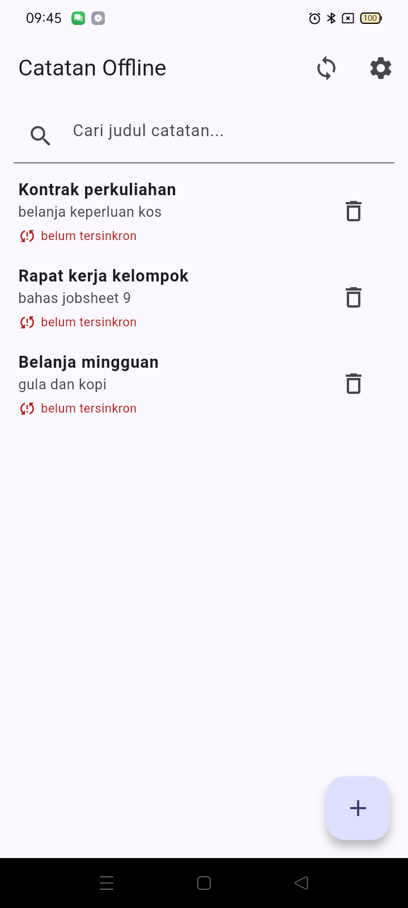
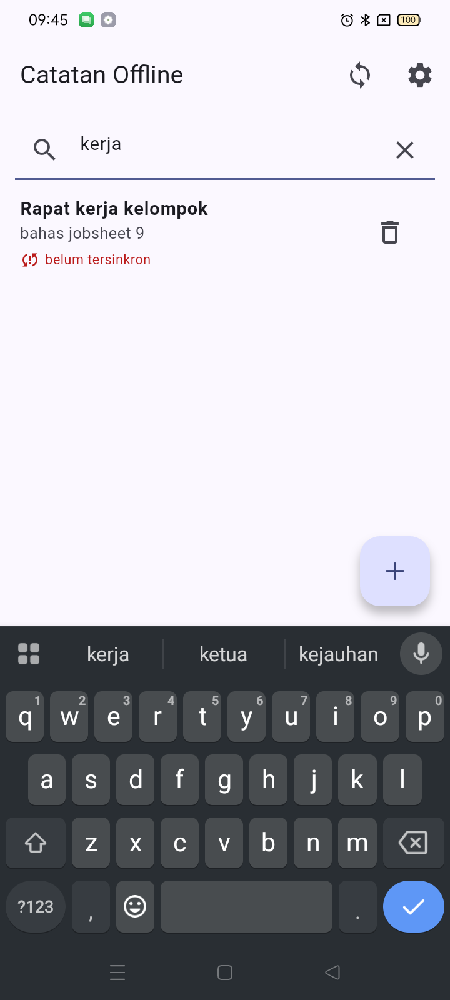
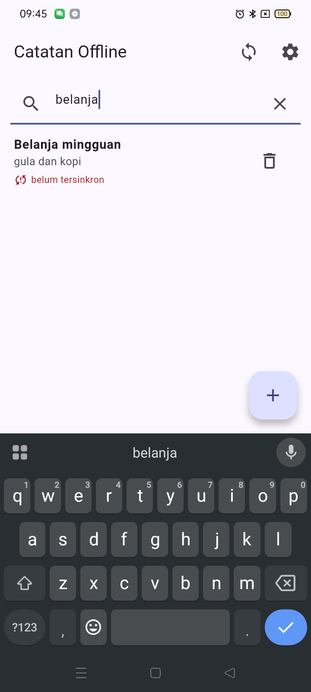
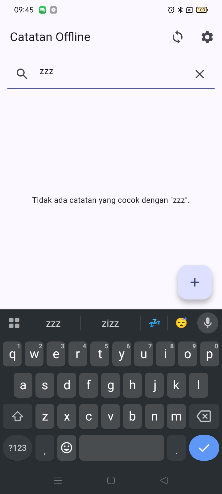

# Laporan Jobsheet #09 — AI-Assisted Development / Vibe Coding (`week5_offline_notes`)

> Mata kuliah: Pemrograman Mobile · Minggu 9 · Project: `week5_offline_notes`
> (SQLite + Riverpod 3, hasil Minggu 5 yang **naik kelas** ke Clean Architecture Minggu 7
> dan disiplin review/CI Minggu 8 sebelum pekerjaan #9 dikerjakan)
> Perangkat uji: OPPO CPH2269, Android 11 (`EQFUD64HBIZDQKTW`) · Tanggal: 30 Oktober 2026
> Branch: `feat/week9-ai-assisted-development` → `develop`

**Daftar isi**

1. [Aturan main yang saya pegang](#aturan-main-yang-saya-pegang)
2. [Prasyarat: membereskan Minggu 5 dulu](#prasyarat-membereskan-minggu-5-dulu)
3. [Prompt — formula 5 slot](#prompt--formula-5-slot)
4. [Verify — 6 langkah, dan tiga temuan yang membantah AI](#verify--6-langkah-dan-tiga-temuan-yang-membantah-ai)
5. [Test — merah dulu, lalu hijau](#test--merah-dulu-lalu-hijau)
6. [Refactor — hasil AI dipindah ke use case domain murni](#refactor--hasil-ai-dipindah-ke-use-case-domain-murni)
7. [AI Verification Challenge — AI mereview kode saya](#ai-verification-challenge--ai-mereview-kode-saya)
8. [Keputusan per file (terima / terima+refactor / tolak)](#keputusan-per-file-terima--terimarefactor--tolak)
9. [Cara menjalankan & hasil di device asli](#cara-menjalankan--hasil-di-device-asli)
10. [Bukti mesin hijau](#bukti-mesin-hijau)
11. [Refleksi](#refleksi)

---

## Aturan main yang saya pegang

Jobsheet #9 tidak menilai fitur yang jadi; ia menilai **kualitas verifikasi**. Karena itu:

- prompt ditulis **netral** — tidak menyebut SQL, `LIKE`, atau layer tujuan, supaya hasil
  yang keluar benar-benar keputusan AI, bukan keputusan saya yang disuruh ulang;
- output mentah AI disimpan **verbatim** dan tidak disunting, termasuk dua klaimnya yang
  ternyata salah;
- setiap klaim AI (termasuk klaim dari AI yang saya pakai sebagai reviewer) punya bukti:
  `flutter analyze`, grep, `git diff --numstat`, atau test yang **merah sebelum fix**;
- minimal 1 temuan terbukti benar lalu diperbaiki, dan minimal 1 temuan ditolak dengan
  alasan teknis tertulis.

Dokumen rinciannya: [`docs/ai-log.md`](docs/ai-log.md) (pusat),
[`docs/prompt-mentah-search-notes.md`](docs/prompt-mentah-search-notes.md),
[`docs/ai-output-mentah.md`](docs/ai-output-mentah.md),
[`docs/GREP_VERIFICATION.md`](docs/GREP_VERIFICATION.md),
[`docs/AI_CHALLENGE.md`](docs/AI_CHALLENGE.md).

## Prasyarat: membereskan Minggu 5 dulu

Sebelum menyentuh #9, proyek Minggu 5 belum lolos syarat #7/#8: strukturnya datar
(`lib/data/**` + `lib/pages/**`), tidak ada `domain/`, `notes_page.dart` mengimpor
`NoteRepository` konkret, dan `sync.dart` memanggil `openNotesDb()` langsung dari dua
tempat. Pekerjaan prasyarat itu dikerjakan di snapshot baru
(`09-week-9-ai-assisted-development/week5_offline_notes/`), folder Minggu 5 tidak disentuh:

- **Bug perilaku lebih dulu, dengan test merah.** `note_detail_page.dart` selalu memanggil
  `addNote` walaupun `noteId > 0`, dan `updateNote` tidak pernah ada di repository →
  mengedit catatan menghasilkan duplikat. Direproduksi sebagai test merah
  (`2c2b623`), baru diperbaiki (`6ac5d07`). Ini bukan refactor, jadi dipisah dari commit
  "nol perubahan perilaku".
- **Restructure feature-first** meniru `campus_notify`: `core/{failures,db}.dart`,
  `features/<fitur>/{domain,data,presentation}`, use case mengembalikan record
  `({List<Note>? notes, Failure? failure})`, `sealed class Failure` murni Dart,
  `presentation/providers/` satu-satunya tempat layer disatukan, `routes.dart` keluar dari
  `main.dart`, `NoteTile` dipecah dari `notes_page.dart` (aturan < 80 baris).
- **`dart format` murni** dijadikan commit tersendiri (`b3687c3`) supaya diff refactor
  hanya berisi perpindahan struktur.
- Fake repository dipaksa `implements` kontrak domain (sebelumnya `extends` kelas konkret,
  yang ikut menyeret `_openDb` ke dalam test).

Rinciannya ada di riwayat commit branch ini; laporan ini sengaja tidak mengambil porsi
refactor — itu materi #7/#8.

## Prompt — formula 5 slot

Fitur yang diminta: **pencarian judul catatan + empty state ketika tidak ada hasil**.
Teks lengkap ada di [`docs/prompt-mentah-search-notes.md`](docs/prompt-mentah-search-notes.md);
inti tiap slot:

| Slot | Isi |
|---|---|
| **Peran** | senior Flutter developer |
| **Konteks** | nama proyek, versi dependensi nyata (`flutter_riverpod ^3.4.3`, `sqflite ^2.4.4`, `go_router ^14.8.0`), struktur feature-first + kontrak `Note`/`NoteRepository`/use case yang sudah ada, **DDL tabel `notes`** |
| **Tugas** | tambahkan pencarian judul di halaman daftar catatan, lengkap dengan empty state "tidak ada hasil" |
| **Batas** | jangan ubah arsitektur, jangan tambah dependensi, jangan sentuh file di luar fitur notes, maksimal 80 baris kode baru |
| **Output** | kode lengkap + 3 test case + cara menjalankan test |

Yang **tidak** saya tempelkan: secret/token (proyek ini memang tidak punya — Minggu 5 belum
memakai Firebase, tidak ada `google-services.json`; dicek, bukan diklaim), dan bukan
seluruh repo — hanya kontrak domain + struktur folder + versi package.

## Verify — 6 langkah, dan tiga temuan yang membantah AI

Verifikasi dilakukan sebelum satu baris pun kode AI masuk ke `lib/`. Tiga di antaranya
membantah klaim AI dengan perintah yang bisa diulang:

| Klaim AI | Bukti | Vonis |
|---|---|---|
| "`StateProvider<String>` untuk query pencarian" | `flutter analyze` → `Error: Undefined name 'StateProvider'`. Di Riverpod 3 kelas itu hanya diekspor dari `package:flutter_riverpod/legacy.dart` (dicek di pub cache), bukan dari import utama yang dipakai proyek | **DITOLAK** — diganti `NotifierProvider<NoteSearchQuery, String>`, padanan non-legacy |
| "`searchNotesProvider = Provider<SearchNotes>(...)`" | `SearchNotes` murni dan tanpa dependensi: tidak ada apa pun untuk di-inject | **DITOLAK** — dibuat langsung di tempat pemakaiannya |
| "file baru ±120 baris, masih di bawah 80" (klaim jumlah) | `git diff --numstat` → **116 added / 8 removed**, dan fungsi `filterNotes` AI 84 baris | **DIBANTAH dengan angka**, bukan opini |
| "`AsyncValue.whenData` tersedia untuk turunan `AsyncValue`" | autocomplete + sumber package: `async_value.dart:168` | **BENAR** — satu-satunya klaim API yang lolos, dan dipakai |

Detail 6 langkah (baca baris per baris → cek import → cek API nyata → `flutter analyze` →
test sukses + test gagal → uji manual) ada di [`docs/ai-log.md`](docs/ai-log.md) §3.

Satu usulan AI lain yang saya tolak dengan alasan teknis dan **sengaja tidak saya
sembunyikan sebagai keputusan**: push-down `LIKE` ke SQLite. Alasannya bukan "SQL
injection" — `where: 'title LIKE ?', whereArgs: ['%$q%']` ber-parameter dan tidak
injectable, jadi klaim itu akan saya tarik sendiri kalau saya tulis. Alasannya: (1) rubrik
#9 menuntut use case domain murni, (2) filter di SQL tidak bisa diuji tanpa DB, dan
(3) `LIKE` SQLite hanya case-insensitive untuk ASCII sementara `String.toLowerCase()` Dart
menangani karakter non-ASCII — dibuktikan test `judul beraksen non-ASCII tetap cocok lintas
huruf besar/kecil`.

## Test — merah dulu, lalu hijau

- Test regresi bug duplikat ditulis lebih dulu dan **di-commit dalam keadaan merah**
  (`2c2b623`), baru `updateNote` dibuat sampai hijau (`6ac5d07`).
- Test unit `SearchNotes`: cocok / tidak cocok / query kosong mengembalikan seluruh daftar /
  case-insensitive / aksen non-ASCII / **`body` sengaja dikecualikan**.
- Test widget: dua empty state berbeda (belum ada catatan vs tidak ada hasil), kolom
  pencarian menyaring daftar, tombol clear, propagasi error, query bertahan melewati mutasi.
- Tidak ada test yang menyentuh SQLite: semuanya lewat `FakeNoteRepository implements
  NoteRepository`.

## Refactor — hasil AI dipindah ke use case domain murni

Kode AI difilter di layer presentasi. Saya pindahkan keputusan penyaringan ke
`lib/features/notes/domain/usecases/search_notes.dart`:

```dart
class SearchNotes {
  const SearchNotes();

  List<Note> call(List<Note> notes, String query) {
    final q = query.trim().toLowerCase();
    if (q.isEmpty) return notes;
    return notes.where((n) => n.title.toLowerCase().contains(q)).toList();
  }
}
```

12 baris, tanpa satu pun import. Presentasi tetap di UI: `noteSearchQueryProvider` (state
UI) + `filteredNotesProvider` (turunan `notesProvider` lewat `whenData`), dan dua empty
state yang berbeda di `NotesList`. Sterilitas domain dibuktikan dengan grep, bukan dengan
klaim — [`docs/GREP_VERIFICATION.md`](docs/GREP_VERIFICATION.md) menyimpan perintah dan
output literalnya (G1–G7, termasuk pelajaran bahwa grep `data/` memberi false positive
sehingga polanya dipertajam jadi `^import .*data/`).

## AI Verification Challenge — AI mereview kode saya

Ronde kedua: AI lain (sub-agent read-only, tidak ikut menulis kode, tidak tahu isi dokumen
ini) saya suruh mereview hasil kerja saya sendiri dengan prompt jobsheet
*"Review kode search Flutter ini sebagai senior dev ... Beri 3 temuan + level"*.

Hasilnya tidak nyaman: **reviewer menemukan bug nyata di kode yang sudah saya klaim
terverifikasi.** Tiap temuan saya tulis sebagai test lebih dulu, jalankan terhadap kode yang
ada, baru diputuskan:

| Temuan AI | Bukti | Keputusan |
|---|---|---|
| #2 (saran) `TextEditingController` lokal dan `noteSearchQueryProvider` adalah dua sumber kebenaran yang tak pernah disinkronkan; remount → kolom kosong di atas daftar yang masih terfilter | test remount **MERAH**: `Expected: 'ker'  Actual: ''` → hijau setelah `initState` menumbuhkan controller dari provider | **DITERIMA + DIPERBAIKI** |
| #1 (disebut *blocker*) `filteredNotesProvider` menelan query saat cabang error | test langsung **LULUS**: `whenData` hanya mentransformasi cabang data, `AsyncError` lewat utuh, halaman tetap menampilkan `LoadError` | **LEVEL DITOLAK**, tapi bagian "tidak ada test yang mengikat kontrak" benar → testnya ditambah |
| #3a `.trim().toLowerCase()` tidak menormalkan Unicode (NFC vs NFD) | skrip `dart run`: `panjang NFC 12, panjang NFD 14`, `query NFC vs judul NFD : false`; sementara case-folding non-ASCII jalan (`Σ` vs `σ` → `true`) | **BENAR tapi TIDAK diperbaiki** — normalisasi butuh dependensi baru, slot Batas prompt melarang; premis pemicunya juga dinyatakan asumsi oleh AI itu sendiri. Batasnya dikunci test dokumentasi |
| #3b/#3c/#3d tombol clear, propagasi error, dan query bertahan melewati `_mutate` belum diuji | tiga test pada kode yang ada: ketiganya **LULUS** | **DITOLAK sebagai bug, DITERIMA sebagai lubang test** — testnya saya tambah, kodenya tidak |

Tabel lengkap + output merah/hijau: [`docs/AI_CHALLENGE.md`](docs/AI_CHALLENGE.md).

## Keputusan per file (terima / terima+refactor / tolak)

Versi lengkap dengan alasan per baris ada di [`docs/ai-log.md`](docs/ai-log.md) §5. Ringkasnya:

| Unit hasil AI | Keputusan | Alasan |
|---|---|---|
| `SearchNotes` (logika `contains` + `trim().toLowerCase()`) | **Terima apa adanya** | benar, murni, 12 baris; dipindah ke `domain/usecases/` |
| filter di layer presentasi | **Terima + refactor** | keputusan bisnis harus di domain; UI hanya menyaring untuk ditampilkan |
| `StateProvider<String>` | **Tolak** | tidak ada di ekspor utama Riverpod 3 (bukti: `flutter analyze` + pub cache) |
| `searchNotesProvider = Provider<SearchNotes>` | **Tolak** | tidak ada dependensi yang bisa di-inject |
| `TextField` di AppBar + `TextEditingController` lokal | **Terima** | `SearchBar` butuh Flutter ≥ 3.29; controller lokal menjaga kursor |
| dua empty state | **Terima + refactor** | dipisah: "belum ada catatan" vs "tidak ada hasil untuk `q`" |
| query `LIKE` push-down ke SQL | **Tolak** | domain jadi tidak murni, tak teruji tanpa DB, `LIKE` hanya ASCII-insensitive |

## Cara menjalankan & hasil di device asli

```
cd 09-week-9-ai-assisted-development/week5_offline_notes
flutter pub get
flutter devices                 # CPH2269 • EQFUD64HBIZDQKTW • Android 11
flutter run -d <device-id>
```

Uji manual di device (OPPO CPH2269, Android 11) dengan tiga catatan yang sengaja dirancang
untuk mengunci keputusan desain:

| Query kosong — 3 catatan | `"kerja"` — cocok judul | `"belanja"` — **judul saja** | `"zzz"` — tidak ada hasil |
|---|---|---|---|
|  |  |  |  |

- **`"belanja"`** adalah bukti paling penting: catatan *"Kontrak perkuliahan"* punya body
  `belanja keperluan kos` tetapi **tidak muncul**, sementara *"Belanja mingguan"* muncul
  walau huruf `B`-nya kapital. Dua keputusan sekaligus terbukti di perangkat: pencarian
  **judul saja**, dan case-insensitive lewat `toLowerCase()` (bukan `LIKE`).
- **`"zzz"`** menampilkan empty state kedua: `Tidak ada catatan yang cocok dengan "zzz".`
- Empty state pertama (belum ada catatan sama sekali) ada di
  `screenshots/week9/w9-05-belum-ada-catatan.png`.
- `screenshots/week9/w9-06-query-bertahan-setelah-kembali.png` mengunci perbaikan temuan #2:
  query tetap tampil di kolom setelah halaman di-remount.

Catatan lingkungan yang saya temukan sendiri: `flutter run` di snapshot ini gagal sebelum
kompilasi karena `android/gradle.properties` warisan Minggu 5 mem-pin
`org.gradle.java.home=C:/Program Files/Java/jdk-21.0.12.1` — path yang sudah tidak ada di
mesin ini. Pin saya hapus (`266cb92`) supaya Gradle memakai `JAVA_HOME`, sama seperti
`campus_notify`. Nol perubahan perilaku aplikasi.

## Bukti mesin hijau

```
$ flutter analyze
No issues found! (ran in 4.4s)

$ dart format --output=none --set-exit-if-changed .
Formatted 39 files (0 changed) in 0.10 seconds

$ flutter test
00:04 +22: All tests passed!
```

Satu jebakan lokal yang saya temukan saat mengambil angka di atas: `dart format .` ikut
memasuki folder `build/` hasil `flutter run` device dan mati dengan
`PathNotFoundException: ... build\shared_preferences_android\.transforms\...` — bukan karena
kode saya tidak rapi. `flutter clean` dulu, baru gerbang format jalan. Di CI masalah ini tidak
muncul karena `dart format` dijalankan sebelum `flutter test` pada checkout bersih.

Gerbang yang sama dijalankan di CI untuk **dua** proyek sekaligus lewat `strategy.matrix`
(`.github/workflows/ci.yml`, commit `e4f71e6`) — minggu 8 tetap terverifikasi, minggu 9 ikut
terverifikasi, dan `fail-fast: false` membuat kegagalan salah satu tidak menyembunyikan
hasil yang lain.

## Refleksi

**1. Satu halusinasi AI apa yang Anda temukan dan bagaimana membuktikannya?**
Dua. Pertama, AI memakai `StateProvider<String>` — di Riverpod 3 kelas itu tidak ada di
ekspor utama `package:flutter_riverpod`, hanya lewat `legacy.dart`. Buktinya bukan tebakan:
`flutter analyze` keluar dengan `Error: Undefined name 'StateProvider'`, dan saya cek ekspor
package di pub cache. Kedua, AI mengklaim kode barunya "±120 baris, masih di bawah 80"
sekaligus mengklaim function-nya pendek; `git diff --numstat` menunjukkan 116 added/8 removed
dan `filterNotes` miliknya 84 baris — melanggar batas 80 yang **prompt saya sendiri** tetapkan.
Keduanya terbukti dengan perintah, bukan dengan perasaan.

**2. Prompt mana yang paling membantu dan apa yang Anda ubah?**
Prompt **review** ("Beri 3 temuan + level blocker/saran + alasan") paling bernilai, karena
ia menemukan bug yang lolos dari verifikasi saya: dua sumber kebenaran pada kolom pencarian.
Teks jobsheet-nya saya perkuat tiga hal: daftar file + path absolut, aturan **READ-ONLY**,
dan kewajiban menyebut **dari mana AI tahu** klaimnya (file/baris pub cache atau perintah
yang dijalankan). Aturan terakhir itu yang membuat reviewer sendiri menandai klaim NFD-iOS
sebagai asumsi — sehingga saya bisa memisahkannya dari klaim yang benar-benar terbukti.
Prompt **generate** juga saya ubah satu kali: versi pertama saya hampir menyebut
"pakai LIKE di SQL"; saya buang, karena itu membuat hasil AI jadi bayangan keputusan saya
sendiri.

**3. Satu refactor apa yang Anda lakukan pada kode AI?**
Memindahkan keputusan penyaringan dari layer presentasi ke use case domain murni,
`SearchNotes` di `domain/usecases/search_notes.dart` — 12 baris tanpa satu pun import,
sehingga bisa diuji tanpa Flutter dan tanpa SQLite. Sekaligus saya buang usulan
`searchNotesProvider`: membungkus objek tanpa dependensi dalam provider hanya menambah
lapisan yang tidak menyelesaikan apa pun.

**4. Keputusan terima/tolak mana yang paling sulit?**
Menolak temuan #3a (normalisasi Unicode NFC/NFD) — karena temuan itu **benar**.
`toLowerCase()` memang bukan normalisasi, dan saya membuktikannya sendiri dengan skrip
sebelum memutus. Yang sulit adalah menerima bahwa kode yang benar punya batas yang saya
ketahui, lalu tetap tidak memperbaikinya: solusinya butuh dependensi baru yang dilarang slot
Batas prompt, premis pemicunya ("keyboard iOS menulis NFD") dinyatakan AI sebagai asumsi,
dan di app ini judul ditulis serta dicari lewat keyboard yang sama. Keputusan saya bukan
"diam", melainkan mengunci batasnya sebagai test bernama
`bates: judul NFD tidak cocok dengan query NFC` supaya keterbatasan itu terbaca sebagai
keputusan, bukan kelalaian. Yang paling mudah justru menyetujui temuan #2 — dan itu
mengingatkan bahwa reviewer asing bisa lebih teliti daripada penulisnya sendiri.
